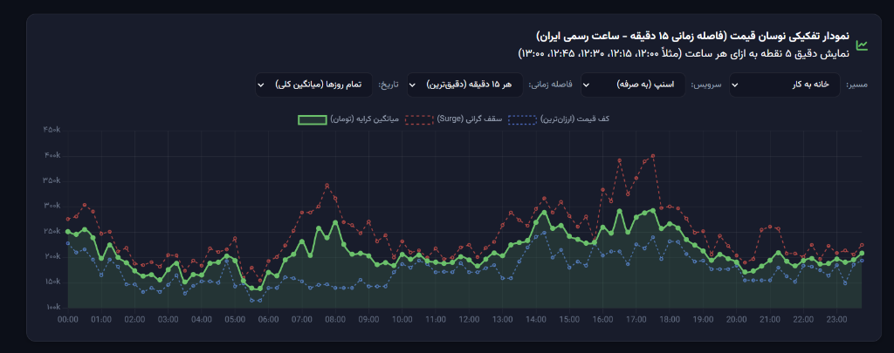
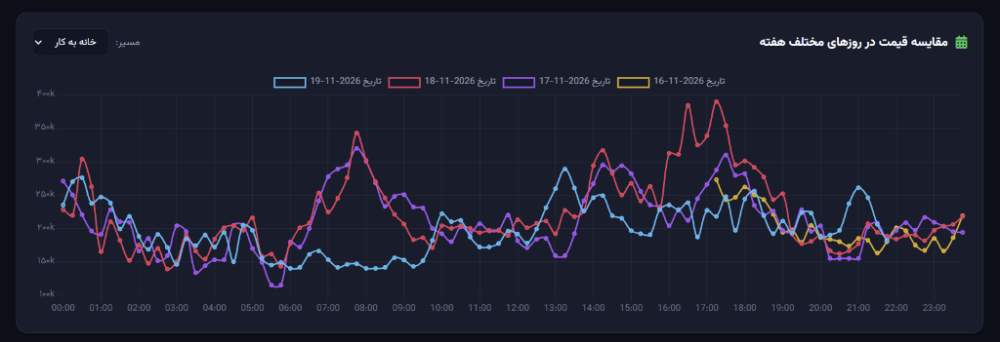
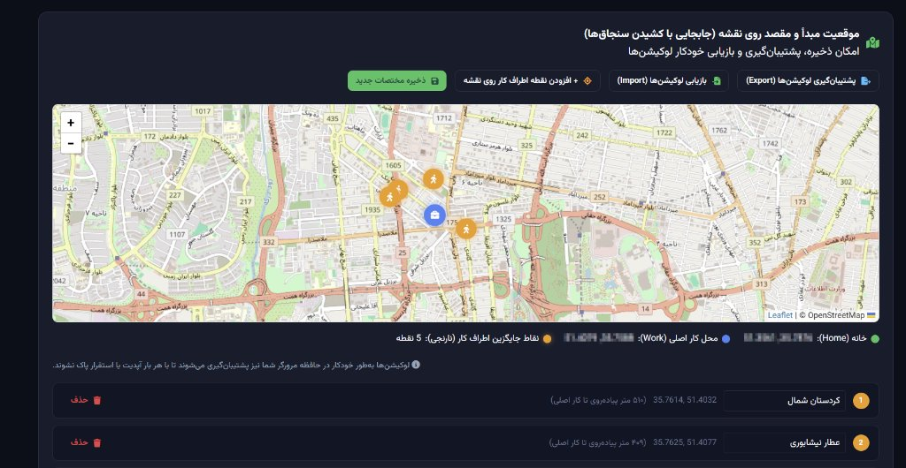
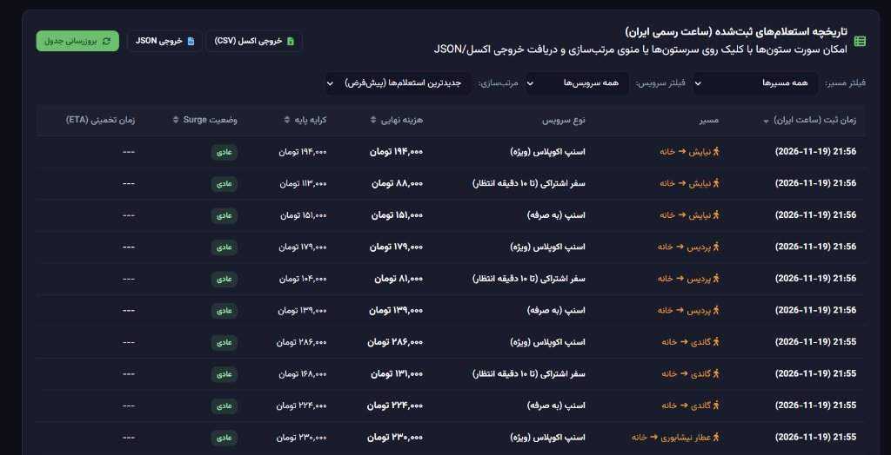

# Snapp Fare Tracker & Commute Analytics

An open-source, self-hosted web dashboard and automated monitoring service designed to track ride fares, analyze price surge fluctuations, and discover optimal departure windows.

---

## Key Features

- **24/7 Round-the-Clock Tracking**: Automated periodic price checks across morning, evening, and continuous intervals.
- **Smart Pickup Comparison**: Monitor your primary workplace alongside nearby walking pickup spots (e.g., transit stations or main boulevards) to find lower fares and bypass local surge pricing.
- **High-Resolution Timeline Charts**: Visualize price curves in 15-minute intervals throughout the day to pinpoint the cheapest times to travel.
- **Multi-Service Support**: Concurrently logs standard Eco rides, EcoPlus, and shared trips.
- **Interactive Map Configuration**: Set and adjust home, office, and alternative pickup coordinates directly via an interactive Leaflet map.
- **Data Export & Portability**: Download complete historical logs in CSV (with Excel UTF-8 support) or JSON format, with backup/restore capabilities for custom pickup locations.
- **Privacy & Security**: Fully self-contained SQLite backend. Optional password protection via environment variables.

---

## Screenshots

### 1. Dashboard Overview & Smart Departure Recommendation
Monitor real-time morning/evening commute fares alongside automated departure time recommendations based on historical surge trends.


### 2. Multi-Origin Pickup Comparison
Compare fares from your main office versus 3–5 nearby walkable spots (e.g. adjacent boulevards, metro exits) to easily avoid localized surge premiums.


### 3. 15-Minute Price Fluctuation Curve
Analyze 24-hour fare distributions plotted every 15 minutes (up to 5 data points per hour) to observe exact surge peaks and valleys.



### 4. Multi-Day Comparative Analytics
Overlay fare trends across different days of the week to identify weekly patterns and price shifts.



### 5. Interactive Map & Custom Pickup Management
Drag and drop pins on Leaflet map to adjust home/work coordinates and add alternative walkable pickup markers with auto-sync and backup/restore.



### 6. Historical Query Logs & Export
Full sortable logs of every query with fare breakdown, surge ratio, and one-click export to CSV (Excel UTF-8 BOM) or JSON.



---

## Architecture & Tech Stack

- **Backend**: Python 3, FastAPI, SQLite, Background Scheduler
- **Frontend**: Vanilla JavaScript (ES6+), Leaflet.js, Chart.js, Vazirmatn Persian typography
- **Containerization**: Docker & Docker Compose

---

## Quick Start Guide

### Option 1: Running with Docker (Recommended)

1. Clone this repository:
   ```bash
   git clone https://github.com/TheMajical/Snapp-Price-Tracker.git
   cd Snapp-Price-Tracker
   ```

2. Copy the sample environment file:
   ```bash
   cp .env.example .env
   ```
   *(Optional)* Set `APP_PASSWORD` in `.env` if you want to require password authentication.

3. Start the container:
   ```bash
   docker-compose up -d
   ```

4. Open your browser and navigate to:
   ```
   http://localhost:8000
   ```

---

### Option 2: Running Locally with Python

1. Create and activate a virtual environment:
   ```bash
   python -m venv venv
   source venv/bin/activate      # On Linux/macOS
   venv\Scripts\activate         # On Windows
   ```

2. Install dependencies:
   ```bash
   pip install -r requirements.txt
   ```

3. Launch the application:
   ```bash
   python run.py
   ```

4. Access the dashboard at `http://localhost:8000`.

---

## Configuration & Usage

1. **Authentication Token**: Open the dashboard, click **تنظیم توکن احراز هویت (Set Token)**, and enter your authorization bearer token.
2. **Set Coordinates**: Use the settings panel or the interactive map to pin your home and workplace locations.
3. **Add Pickup Points**: Add up to 3-4 alternative nearby pickup points to evaluate walk-and-ride fare differences.
4. **Data Seed (Optional)**: Click **بارگذاری داده‌های نمونه** on first launch to populate historical sample data and preview all analytics graphs immediately.

---

## Environment Variables

| Variable | Description | Default |
| :--- | :--- | :--- |
| `APP_PASSWORD` | Optional password for HTTP Basic Authentication | *None (unlocked)* |
| `DATA_DIR` | Directory path where SQLite database and configs are stored | `./data` |

---

## License

This project is licensed under the MIT License. See the [LICENSE](LICENSE) file for details.
